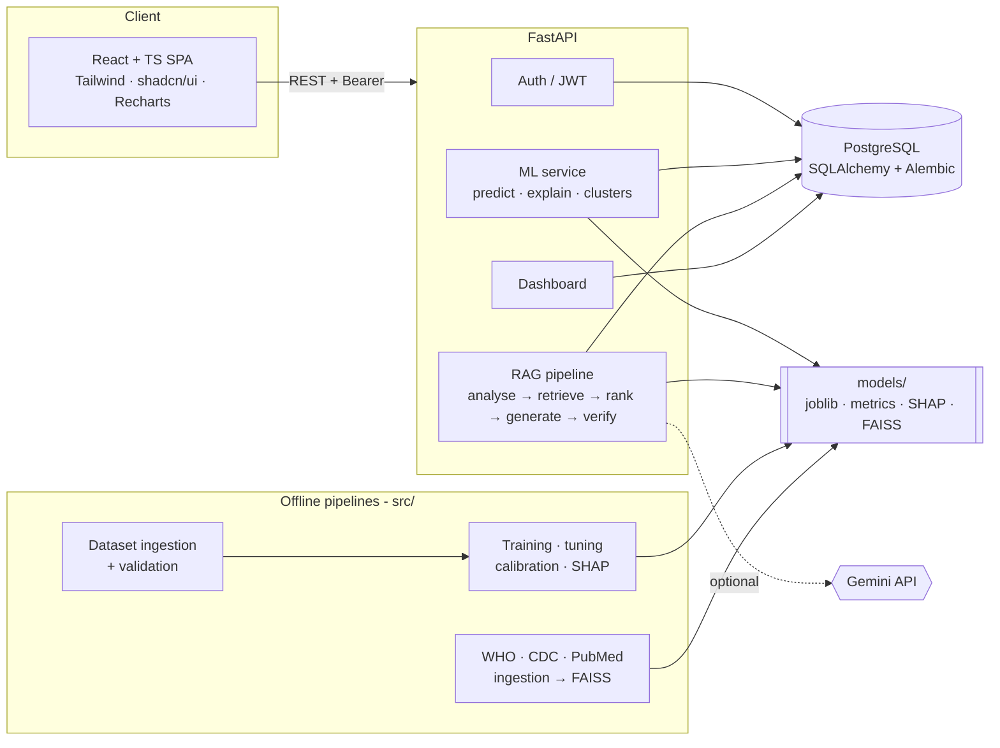

# MediCore AI

**Health information in plain words: ask questions, understand your lab results, check your risk, and keep track of your medicines. Every answer shows its sources.**

> ⚠️ MediCore AI does **not** diagnose, prescribe, or replace a qualified healthcare professional.
> Risk estimates come from a model trained on a public 2015 survey and are **not clinically validated**.
> In an emergency, contact your local emergency services.

---

## 1. Problem statement

Health information is hard for non-experts to interpret, and general-purpose chatbots can give fluent but
unsupported or outdated answers. MediCore AI explores how classical ML, explainability and
retrieval-augmented generation (RAG) can be combined so that **every output can be traced back to data or
to a cited source**, and so that the system says when it does not know.

## 2. Objectives

1. Train, compare and calibrate risk models on a documented public dataset, and report honest held-out metrics.
2. Explain every prediction (SHAP) without implying causation.
3. Answer health questions only from retrieved WHO / CDC / PubMed evidence, with citations, claim
   verification and an explicit "insufficient evidence" path.
4. Measure retrieval and generation quality on a labelled benchmark instead of claiming it.
5. Ship it as a secure, tested, deployable full-stack application.

## 3. Made for everyday people

The whole app is written for people with no medical or technical background:
- **Plain words everywhere.** Menus say "Ask a Question", "My Lab Results", "Health Check", "Find Care Nearby" and "Medicine Reminders", not "RAG", "SHAP" or "predictive analytics". The technical pages still exist under **How it works** for people who want them.
- **Results you can picture.** The Health Check says "about 18 in 100 people with answers like yours…" and draws 100 people, instead of showing a calibrated probability.
- **Clear next steps** after every result, and an emergency notice wherever it matters.
- **Friendly forms.** Questions are written as full sentences, nothing is pre-answered, and there is a height-and-weight helper for BMI.
- **Calm error messages** with no developer jargon, and a **Help and safety** page with emergency numbers.
- **Privacy pages** (Help, Privacy policy, Terms) that describe what the software actually does.
- **Accessible and phone-friendly:** skip link, labelled controls, keyboard use, and a layout checked at 390 px wide.
- A **test fails if jargon creeps back** into an everyday screen.

> Before a public launch, have the Privacy policy and Terms reviewed by a qualified professional for your country,
> and set `OPERATOR_NAME` and `SUPPORT_EMAIL` (see `.env.production.example`).

## 4. Feature status

| Module | Status | Notes |
|---|---|---|
| Landing page, auth (register / login / forgot + reset / change password), protected routes | ✅ Implemented | bcrypt, JWT, single-use reset tokens, rate limits |
| Dashboard | ✅ Implemented | Your own activity plus clearly labelled population statistics |
| Predictive analytics (risk estimate, model comparison, ROC/PR/calibration, threshold trade-off, history) | ✅ Implemented | 7 tuned models; XGBoost selected |
| Patient segmentation (K-Means, elbow, silhouette, PCA) | ✅ Implemented | Statistical groupings, not diagnoses |
| Explainable AI (global importance, beeswarm, individual explanations) | ✅ Implemented | SHAP |
| AI Healthcare Assistant (RAG) | ✅ Implemented | Retrieval, ranking, safety triage, chat history, citations, claim checks. **AI-written answers use Gemini (`GEMINI_API_KEY`).** Without a key, or if Gemini is down or over quota, the assistant answers with sentences quoted verbatim from the sources, each with its citation. It never generates text in that mode |
| RAG evaluation dashboard | ✅ Implemented | Retrieval metrics measured; generation metrics pending an API key |
| Medical report analyzer | ✅ Implemented | PDF text layer with table-row reconstruction, plus Tesseract OCR for scans/images. Units and reference ranges are kept exactly as printed, and no range is ever assumed. Plain-language explanations with grounded source links, history, summary PDF, delete. Files are not stored |
| Healthcare locator | ✅ Implemented | Hospitals, clinics and pharmacies from OpenStreetMap (Overpass + Nominatim) on a Leaflet map, with phone, website, hours and directions links. Mirror fallback, caching, and a clear error when the provider is down. Location is never stored |
| Medication reminders | ✅ Implemented | Daily, every-other-day, weekly or as-needed schedules. Today's doses with taken/skipped logging, 30-day history, pause/resume/edit/delete, and in-tab browser alerts. Reminder-only: no dose advice |
| Settings and privacy | ✅ Implemented | Profile, password change, reminder alerts, automatic retention (30–365 days), JSON data export, per-category deletion, and account deletion with password + typed confirmation |

All modules in the specification are implemented. There are no placeholder pages.

## 5. Architecture



The detailed design (schema, routes, roadmap) is in [docs/ARCHITECTURE.md](docs/ARCHITECTURE.md).

## 6. Technology stack

| Layer | Tools |
|---|---|
| Frontend | React 19, TypeScript, Vite, Tailwind CSS v4, shadcn/ui (Radix), Lucide, Recharts, React Router 7, Axios, React Hook Form, Zod, react-markdown |
| Backend | Python 3.12, FastAPI, Pydantic v2, SQLAlchemy 2, Alembic, PyJWT, bcrypt, slowapi |
| ML / DS | pandas, NumPy, SciPy, scikit-learn, XGBoost, SHAP, joblib, Matplotlib, Seaborn |
| RAG / GenAI | Sentence Transformers (`all-MiniLM-L6-v2`), FAISS, LangChain text splitters, Google Gemini (`google-genai`), BeautifulSoup |
| Data | PostgreSQL 16 (SQLite supported for local development and tests) |
| Ops | Docker, Docker Compose, GitHub Actions CI, Render (API) / Vercel (SPA) |

## 7. Machine-learning methodology

Full write-up: **[docs/ML_METHODOLOGY.md](docs/ML_METHODOLOGY.md)**. Executed notebooks: [notebooks/](notebooks/).

* **Data:** [UCI CDC Diabetes Health Indicators](https://archive.ics.uci.edu/dataset/891/cdc+diabetes+health+indicators)
  (DOI 10.24432/C53919), 253,680 BRFSS 2015 survey responses, 21 features. The target is self-reported
  prediabetes or diabetes, at 13.9 % prevalence. The source and SHA-256 checksum are recorded in `data/raw/PROVENANCE.json`.
* **Splits:** stratified 60 / 20 / 20.
  * Train: tuning and fitting.
  * Validation: model selection, isotonic calibration and threshold choice.
  * Test: reported once.
* **Leakage control:** all preprocessing (winsorising, imputation, scaling, one-hot encoding,
  feature engineering) sits inside an sklearn `Pipeline`. EDA runs on the training split only.
* **Models:** Logistic Regression, Decision Tree, Random Forest, linear SVM (calibrated), KNN,
  HistGradientBoosting and XGBoost. Each is tuned with Grid or Randomized search using stratified 3-fold
  CV, scored by **PR-AUC** (not accuracy).
* **Threshold:** maximises F2 on validation, treating false negatives as costlier for a screening-style tool.

### Model evaluation results (held-out test set, n = 50,736)

| Model | Test ROC-AUC | Test PR-AUC | Recall | Precision | Specificity |
|---|---|---|---|---|---|
| **XGBoost (selected)** | **0.827** | **0.416** | 0.855 | 0.278 | 0.640 |
| HistGradientBoosting | 0.827 | 0.414 | 0.837 | 0.287 | 0.663 |
| Random Forest | 0.822 | 0.406 | 0.836 | 0.282 | 0.655 |
| Linear SVM (calibrated) | 0.820 | 0.393 | 0.834 | 0.283 | 0.658 |
| Logistic Regression | 0.820 | 0.392 | 0.832 | 0.286 | 0.664 |
| KNN | 0.813 | 0.391 | 0.841 | 0.268 | 0.628 |
| Decision Tree | 0.815 | 0.390 | 0.838 | 0.275 | 0.642 |

XGBoost's 95 % bootstrap CIs are ROC-AUC [0.822, 0.832] and PR-AUC [0.405, 0.429]. All models are close,
so the choice of XGBoost is marginal. The operating point catches about 85 % of positive respondents at
roughly 28 % precision. That is a deliberate screening trade-off, and the full threshold table is shown in the app.

**Explainability.** The features with the highest mean |SHAP| on held-out data are self-rated general
health, age, BMI, cardiometabolic condition count and high blood pressure. These are associations, not causes.

**Segmentation.** K-Means picked k = 4 (best silhouette in 3–6; elbow at 3), but the silhouette is only
≈ 0.17, so the respondent groups overlap substantially. They are presented as descriptive profiles only.

## 8. RAG workflow

Full details, measured results and limits: **[docs/RAG.md](docs/RAG.md)**.

```
question ─► understand: spelling repair · everyday phrase → medical terms · rewrites · safety triage
         ─► 1 direct search      FAISS vectors + BM25 keywords, fused (reciprocal-rank fusion)
         ─► 2 rewritten search   if the evidence is not strong
         ─► 3 per-source search  if still not strong: each trusted source on its own
         ─► rank   relevance · keywords · source authority · freshness · word coverage · title match
         ─► select no near-duplicates · ≤ 2 chunks per document · no single source dominates
         ─► judge  strong → full cited answer | limited → cautious answer, clearly labelled | none → honest "could not find"
         ─► answer Short answer · What may explain it · What you can do · When to get medical help · questions that could help
         ─► verify each sentence is compared with the sources; unmatched ones are marked
```

**Sources** (`python -m src.rag_ingestion.build_index`): WHO (16), CDC (53), **MedlinePlus (1,017)**, PubMed (62), giving
1,148 documents and 4,586 passages. Every document stores its source, URL, type, date and chunk id.
**NHS** works through its official API once you set `NHS_API_KEY` (free key; not yet run against the live API).
**Mayo Clinic** has no public API and blocks automated access, so it is not crawled; licensed content can be imported
from `data/external/licensed/`.

**Safety:** emergency alert, "may need prompt advice" for urgent patterns, no diagnosis, no medicine advice or doses,
and a plain statement of uncertainty when evidence is limited.

### RAG evaluation results (80-question everyday benchmark, K = 4)

| Strategy | Precision@4 | Recall@4 | Hit@4 | MRR |
|---|---|---|---|---|
| Basic (vectors only) | 0.446 | 0.564 | 0.814 | 0.721 |
| Adaptive (previous default) | 0.400 | 0.577 | 0.857 | 0.748 |
| **Hybrid (new default)** | **0.496** | **0.633** | **0.886** | **0.801** |

- On misspelled or incomplete questions, Hit@4 rises from 0.43 to **1.00**.
- On vaguely worded questions, hybrid is **not** better than plain vector search.
- Citations: 100 % point to a real source. Fallback and safety behaviour: 80 of 80 correct, but two safety patterns were
  found and fixed using this benchmark, so that figure is not independent.
- Answer correctness is only an **automatic proxy** (92.9 % of answers match at least half the key points).
- **Gemini-written answers are not yet evaluated** (no API key). Run `python -m app.rag.qa_evaluation --llm` once set.

Older 35-question benchmark (`python -m app.rag.evaluation`), kept for comparison: basic / reranked / adaptive all had
Hit@4 = 1.0 on that smaller, easier set.

## 9. Database design

There are 11 normalised tables: `users`, `user_profiles`, `conversations`, `chat_messages`,
`medical_reports`, `extracted_lab_results`, `model_versions`, `predictions`, `reminders`,
`reminder_events` and `activity_logs`. All have integer primary keys and timestamps. User-owned rows
cascade on user deletion, are indexed by `user_id`, and every query is filtered by the authenticated
user. Migrations are managed with Alembic (`backend/alembic/`). See [docs/ARCHITECTURE.md §5](docs/ARCHITECTURE.md).

## 10. API

Interactive docs are served at **`/api/docs`** (OpenAPI).

| Method | Path | Purpose |
|---|---|---|
| POST | `/api/auth/register` · `/login` · `/forgot-password` · `/reset-password` · `/change-password` | Authentication |
| GET | `/api/auth/me` | Current user |
| GET | `/api/dashboard/summary` · `/analytics` | User-scoped summary · labelled population stats |
| POST | `/api/ml/predict` · `/api/ml/explain` | Calibrated estimate + SHAP (predict is saved to history) |
| GET | `/api/ml/models` · `/model-performance` · `/feature-importance` · `/clusters` · `/predictions` | Model registry, metrics, global SHAP, segments, history |
| POST | `/api/chat` | Evidence-grounded answer (`adaptive` / `reranked` / `basic`) |
| GET | `/api/chat/history` · `/api/chat/{id}` | Conversation list · messages |
| DELETE | `/api/chat/{id}` | Delete a conversation |
| GET | `/api/rag/status` · `/api/rag/evaluation` | Knowledge-base and LLM status · evaluation report |
| POST | `/api/reports/upload` | Analyse a PDF/PNG/JPG lab report (multipart, ≤ 10 MB) |
| GET | `/api/reports` · `/api/reports/{id}` · `/api/reports/{id}/summary.pdf` | History · detail with explanations · downloadable summary |
| DELETE | `/api/reports/{id}` | Delete a report and its extracted values |
| GET | `/api/locations?lat&lon` or `?q=place` | Nearby hospitals / clinics / pharmacies (`category`, `radius_m`) |
| GET, POST | `/api/reminders` | List · create |
| PUT, DELETE | `/api/reminders/{id}` | Update (incl. pause) · delete |
| GET | `/api/reminders/schedule?day=` · `/api/reminders/history` | Doses due on a local date · logged doses |
| POST | `/api/reminders/{id}/events` | Log a dose as taken / skipped |
| GET, PUT | `/api/users/me/profile` | Profile, alerts, retention |
| GET | `/api/users/me/export` | Download all personal data (JSON) |
| POST | `/api/users/me/purge` | Delete one category of data |
| DELETE | `/api/users/me` | Delete account (password + `"DELETE"`) |
| GET | `/api/health` | Liveness |

Errors use one envelope: `{"error": {"code", "message", "details?"}}`.

## 11. Installation

**Prerequisites:** Python 3.12, Node 20+ (22 recommended), and optionally Docker.

```bash
git clone <your-fork> medicore-ai && cd medicore-ai
cp .env.example .env            # then set JWT_SECRET_KEY (and GEMINI_API_KEY for AI answers)
```

### Backend

```bash
cd backend
python -m venv .venv && source .venv/bin/activate        # Windows: .venv\Scripts\activate
pip install --index-url https://download.pytorch.org/whl/cpu torch
pip install -r requirements.txt
alembic upgrade head                                     # creates the schema (SQLite or PostgreSQL)
```

### Data, models and knowledge base (run from the project root, takes about 15 minutes)

```bash
python -m src.ingestion.download          # fetch dataset + provenance
python -m src.preprocessing.validate      # validate, split
python -m src.evaluation.eda              # EDA report + figures
python -m src.training.train              # tune, compare, calibrate, save (about 8 min on 8 cores)
python -m src.evaluation.explain_global   # global SHAP
python -m src.segmentation.cluster        # K-Means segments
python -m src.rag_ingestion.build_index   # WHO / CDC / PubMed → FAISS
python -m src.rag_ingestion.benchmark     # validate RAG benchmark labels
(cd backend && python -m app.rag.evaluation)   # RAG evaluation report
```

### Run (development)

```bash
cd backend && uvicorn app.main:app --reload --port 8000
cd frontend && npm install && npm run dev               # http://localhost:5173 (proxies /api to :8000)
```

Open **http://localhost:5173**. The SPA calls `/api` on its own origin, so there is no CORS setup in development.

### Production (Docker: PostgreSQL + Redis + API + nginx)

Run the data/model steps above first, because the API image packages `models/`. Then:

```bash
cp .env.production.example .env     # fill in JWT_SECRET_KEY, POSTGRES_PASSWORD, GEMINI_API_KEY, ...
docker compose up -d --build        # http://localhost:8080
```

See **[docs/DEPLOYMENT.md](docs/DEPLOYMENT.md)** for HTTPS, backups, upgrades, scaling, split hosting and the
security checklist.

### Tests

```bash
cd backend && pip install -r requirements-dev.txt && python -m pytest   # 79 tests
#   auth & session revocation, ML, prediction API, RAG + fallback, chat, reports, reminders, locator + provider
#   fallback, settings/privacy, production config refusal, security headers, readiness, rate limits
cd frontend && npm test                 # 19 component tests
python e2e/smoke.py --base-url http://localhost:8080 --channel chrome   # real-browser smoke test of every module
```

## 12. Environment variables

See [.env.example](.env.example). The key variables are:

| Variable | Purpose |
|---|---|
| `JWT_SECRET_KEY` | Required. 32+ random characters in production |
| `DATABASE_URL` | PostgreSQL URL, or `sqlite:///./medicore.db` for local development |
| `CORS_ORIGINS` | Comma-separated allowed frontend origins |
| `GEMINI_API_KEY` / `GEMINI_MODEL` | Enables AI answer generation |
| `SMTP_*`, `FRONTEND_URL` | Password-reset email (in development without SMTP, the link is printed to the server log) |
| `VITE_API_BASE_URL` | Frontend → API base URL |

## 13. Deployment

Production runs as one Docker Compose stack:
- nginx serves the SPA and proxies `/api` on the same origin, so there's no CORS.
- The FastAPI API runs as multiple uvicorn workers.
- PostgreSQL holds the data, and Redis backs the rate limits.
- A one-shot migration step runs before the API starts.

Full guide, including split Render + Vercel hosting: **[docs/DEPLOYMENT.md](docs/DEPLOYMENT.md)**.

## 14. Screenshots

Not yet added. They will be captured from the running app rather than mock-ups.

## 15. Limitations

* The risk model reflects self-reported US survey data from 2015. It has no laboratory values, and its
  label merges prediabetes with diabetes. Subgroup fairness has not been audited.
* RAG coverage is limited to 131 documents. PubMed content is abstracts only. Retrieval can still
  accept an out-of-scope medical question, as the benchmark showed.
* The report parser is rule-based and tested only on synthetic reports. Unusual layouts may be missed (they are reported as "no values found", never guessed). OCR quality depends on the scan, and OCR requires Tesseract on the server.
* The locator depends on public OpenStreetMap services, which are sometimes overloaded. When they are, the app shows a clear error rather than placeholder places. Coverage and opening hours vary by region.
* Reminder alerts work only while MediCore is open in a browser tab. There are no email or push reminders yet.
* Data retention is applied at login and when settings are saved, not by a scheduled background job.
* Without a Gemini key the assistant only quotes source sentences. That is accurate, but less fluent than a written answer and can include a loosely related sentence.
* The claim verifier is a heuristic. "Supported" means "resembles the sources", not "medically verified".
* The RAG benchmark is small, with a single annotator.

## 16. Future enhancements

1. Phase 11: deployment hardening (run on PostgreSQL in Docker, Render/Vercel deploy, README screenshots).
2. Report analyzer: wider analyte coverage, multi-column layouts with ranges on a separate line, and a labelled evaluation set of real-world report formats.
3. Measure generation metrics with Gemini, and add an LLM-based entailment check to the verifier.
4. A held-out RAG benchmark for threshold tuning, plus a stricter out-of-scope gate (query-term grounding).
5. A cross-encoder reranker, and a subgroup fairness audit of the risk model.

## 17. Credits

* Dataset: CDC Diabetes Health Indicators, UCI Machine Learning Repository, DOI 10.24432/C53919, derived from CDC BRFSS 2015.
* Knowledge sources: World Health Organization fact sheets, the U.S. CDC content-syndication API, and
  NCBI PubMed (abstracts © their publishers; linked by PMID).
* Open-source libraries listed in `backend/requirements.txt` and `frontend/package.json`.
